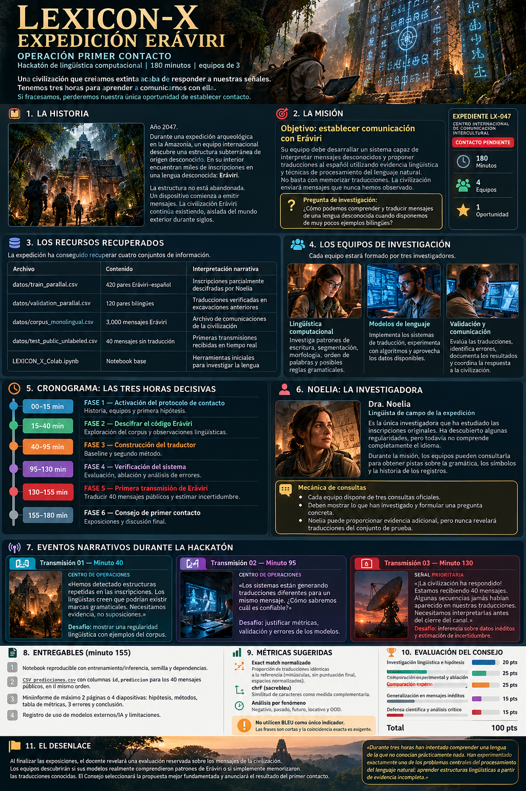

<div align="center">

# 🗿 LEXICON-X — Expedición Eráviri
### OPERACIÓN PRIMER CONTACTO
**Hackatón de lingüística computacional · 180 minutos · 5 equipos de 3**



> **Una civilización que creíamos extinta acaba de responder a nuestras señales. Tenemos tres horas para aprender a comunicarnos con ella.**

</div>

## 📡 1. El despertar de Eráviri

**Año 2047.** Una expedición arqueológica en una región inexplorada de la Amazonía descubre una estructura subterránea. Miles de inscripciones muestran una lengua desconocida: **Eráviri**.

La estructura no está abandonada. Un dispositivo comienza a emitir mensajes: sus habitantes parecen continuar existiendo, aislados durante siglos. El canal de comunicación permanecerá activo solo **180 minutos**.

La investigadora **Noelia** ha conseguido descifrar algunas inscripciones. Sin embargo, nadie entiende todavía los nuevos mensajes.

**Ustedes son el equipo científico convocado para establecer el primer contacto.**

## 🎯 2. La misión

> **Pregunta de investigación:** ¿Qué estrategia permite generalizar mejor a combinaciones nuevas cuando las traducciones paralelas son escasas?

Desarrollen un sistema reproducible para traducir mensajes inéditos de Eráviri al español. No basta memorizar ejemplos: deberán investigar el vocabulario, el orden de palabras, las regularidades morfológicas y la estructura gramatical.

Cada equipo debe formular una **hipótesis falsable**, implementar un **baseline**, compararlo con al menos **otro enfoque** y analizar errores.

## 🗃️ 3. Recursos recuperados

| Archivo | Contenido | Historia |
|---|---|---|
| `datos/train_parallel.csv` | 420 pares bilingües | Inscripciones descifradas por Noelia |
| `datos/validation_parallel.csv` | 120 pares bilingües | Traducciones verificadas |
| `datos/corpus_monolingual.csv` | 3,000 oraciones en Eráviri | Archivo histórico de comunicaciones |
| `datos/test_public_unlabeled.csv` | 40 mensajes sin traducción | Primera transmisión recibida |
| `LEXICON_X_Colab.ipynb` | Notebook base | Laboratorio de investigación |

> **Importante:** Los archivos de datos y el notebook deben añadirse al repositorio antes de la actividad. Este paquete incluye el README y la imagen de presentación, no los datasets.

## 👥 4. Roles del equipo

Cada equipo está formado por **tres investigadores**. Todos deben comprender y defender la solución completa.

- **Especialista en lingüística computacional:** segmentación, morfología, n-gramas, orden de palabras y reglas.
- **Especialista en modelos de lenguaje:** baseline, modelos alternativos, experimentación e inferencia.
- **Especialista en validación y comunicación:** métricas, análisis de errores, reproducibilidad y defensa.

## ⏳ 5. Cronograma de la operación

| Tiempo | Fase | Misión |
|---|---|---|
| **00–15 min** | 📡 Activación del protocolo | Historia, equipos e hipótesis inicial |
| **15–40 min** | 🔎 Descifrar el código | EDA y tres observaciones lingüísticas con evidencia |
| **40–95 min** | 🧠 Construir el traductor | Baseline y segundo método |
| **95–130 min** | 🧪 Verificar el sistema | Métricas, ablación y tres errores analizados |
| **130–155 min** | 🚨 Primera transmisión | CLASIFICADO! |
| **155–180 min** | 🏛️ Consejo de primer contacto | Cuatro defensas de 5 minutos y 5 minutos de discusión |

## 👩‍🔬 6. Noelia, lingüista computacional de campo

Noelia es la investigadora que ha estudiado las inscripciones originales. Tiene pistas, **no una traducción completa**.

**Mecánica:** cada equipo dispone de **tres consultas oficiales**. Para consultar, debe presentar un hallazgo propio y formular una pregunta concreta. Noelia puede proporcionar evidencia adicional preparada por el docente, pero no revelar respuestas del test.

> «He observado partículas que aparecen cerca de las acciones. ¿Podrían determinar si expresan tiempo, negación u otra categoría?»

> «Sus traducciones reconocen términos, pero ¿qué evidencia tienen de que Eráviri sigue el orden del español?»

> «¿Qué aprendería un Transformer con solo 420 pares? ¿Cómo podrían aprovechar los mensajes monolingües?»

## 🚨 7. Transmisiones de emergencia

### 📻 Minuto 40 — Estructuras repetidas

> **Centro de operaciones:** «Detectamos patrones recurrentes en las inscripciones. Necesitamos evidencia de al menos una regularidad lingüística; no bastan las suposiciones».

**Desafío:** mostrar una regularidad y ejemplos que la respalden.

### 📻 Minuto 95 — Traducciones contradictorias

> **Centro de operaciones:** «Los traductores producen respuestas distintas para un mismo mensaje. ¿Cuál deberíamos considerar más confiable?»

**Desafío:** justificar las métricas y explicar errores.

### 📻 Minuto 130 — ¡Contacto!

> **Señal prioritaria:** «CLASIFICADO!».

**Desafío:** CLASIFICADO.

## 📦 8. Entregables — fecha límite: minuto 155

1. **Notebook reproducible:** entrenamiento e inferencia, semilla y dependencias.
2. **`predicciones.csv`:** columnas `id,prediccion`, exactamente 40 filas, mismo orden que el archivo público.
3. **Miniinforme:** máximo 2 páginas o 4 diapositivas; hipótesis, métodos, métricas, tres errores y conclusión.
4. **Registro de herramientas:** modelos externos, asistentes de IA, bibliotecas y limitaciones.

Ejemplo de formato del CSV (valores ilustrativos, **no son traducciones reales**):

```csv
id,prediccion
1,el viajero llega mañana
2,no encontramos el camino
```

## 📏 9. Evaluación científica

- **Exact match normalizado:** proporción de traducciones idénticas tras convertir a minúsculas, eliminar puntuación final y normalizar espacios.
- **chrF (sacrebleu):** similitud a nivel de caracteres como métrica complementaria.
- **Análisis por fenómeno:** negación, pasado, futuro, locativo y combinaciones fuera de distribución (OOD).
- **Ablación:** eliminar un componente y medir su contribución, sin cambiar simultáneamente otros factores.

**No usen BLEU como único indicador:** las frases cortas hacen que su interpretación sea especialmente delicada.

| Criterio | Puntos |
|---|---:|
| Investigación lingüística e hipótesis | 20 |
| Implementación y reproducibilidad | 25 |
| Comparación experimental y ablación | 25 |
| Generalización en mensajes inéditos | 15 |
| Defensa y análisis crítico | 15 |
| **Total** | **100** |

**No gana necesariamente quien obtenga mayor exactitud**, sino quien presente la investigación más rigurosa, reproducible y defendible.

## 📜 10. Reglas de la expedición

1. Equipos de tres; todos deben poder defender la solución.
2. Se permiten bibliotecas, modelos preentrenados, asistentes de IA e internet, **siempre que se declaren**.
3. **Está prohibido** buscar o usar archivos privados del docente.
4. No ajusten manualmente las traducciones de validación frase por frase. Úsenlas para comparar decisiones metodológicas.
5. No es obligatorio entrenar un Transformer desde cero. Un experimento fallido, bien analizado, también aporta evidencia.
6. El idioma es **sintético**. No extrapolen conclusiones directamente a lenguas indígenas reales.
7. La evaluación oficial se realizará con datos ocultos que no recibirán durante la sesión.

## 🗣️ 11. Consejo de primer contacto

Cada equipo tendrá **5 minutos** para responder:

- ¿Qué evidencia sostiene el orden de palabras que proponen?
- ¿Cómo separaron el aprendizaje de vocabulario del aprendizaje de estructura?
- ¿Qué aportó el corpus monolingüe? ¿Cómo lo comprobaron?
- ¿Cómo evitaron fuga de datos y sobreajuste a validación?
- ¿Dónde falla su traductor: negación, tiempos verbales, lugares o combinaciones inéditas?
- ¿Qué experimento harían con una semana adicional?

### 🌌 El desenlace

El Consejo Científico revelará la evaluación reservada y decidirá si se logró un contacto **exitoso, parcial o todavía no resuelto**.


---

<div align="center">

**LEXICON-X · OPERACIÓN PRIMER CONTACTO**

*La señal sigue activa. El tiempo corre.*

</div>
